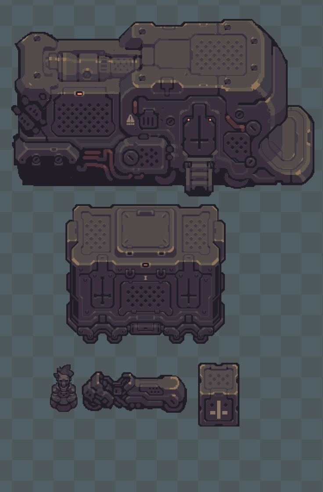
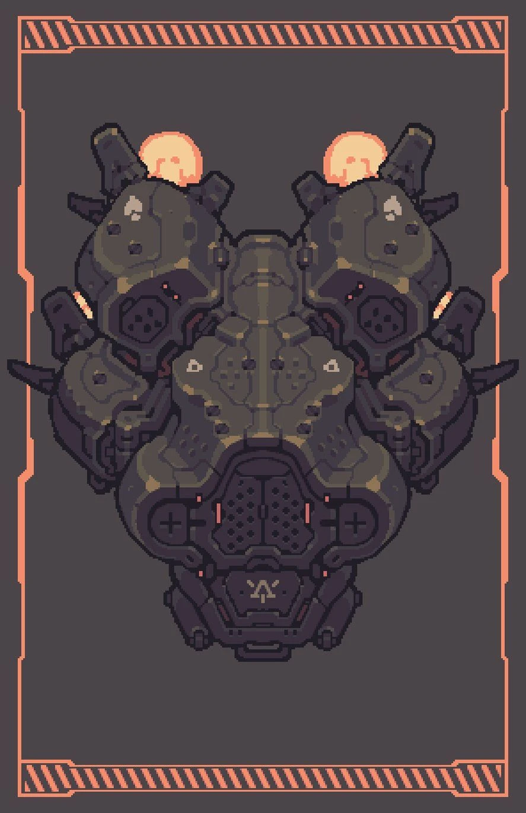
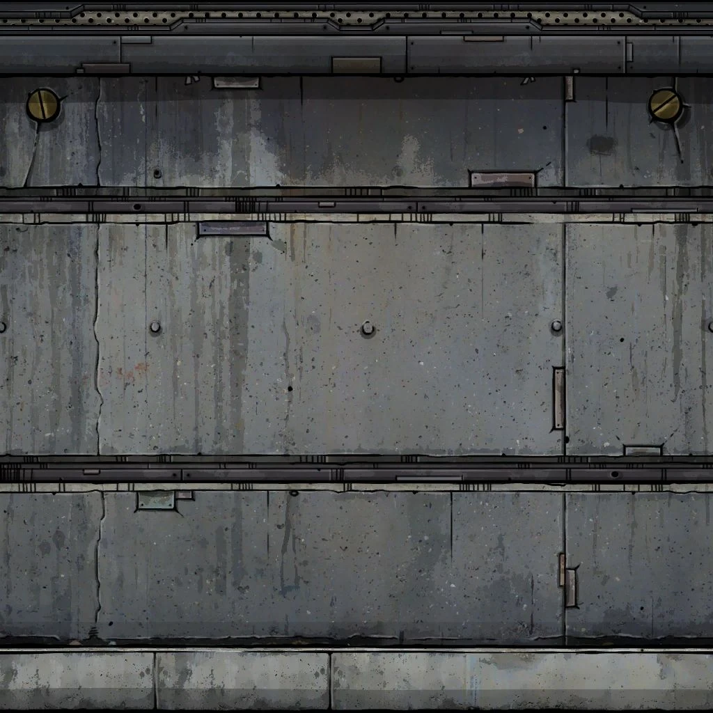
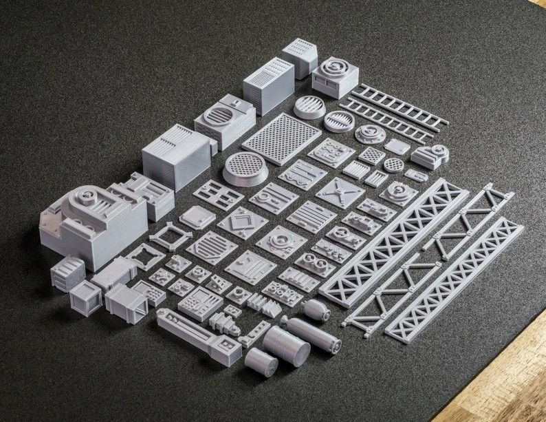
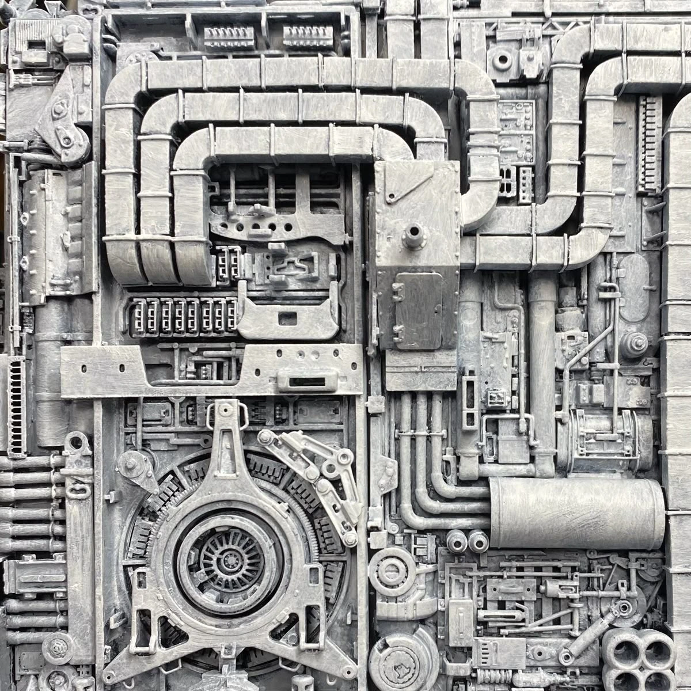
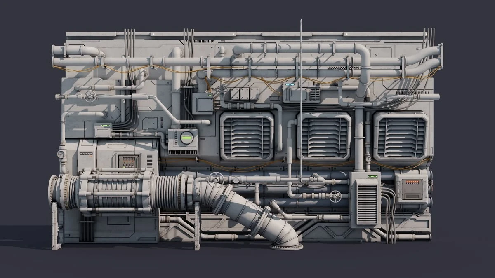
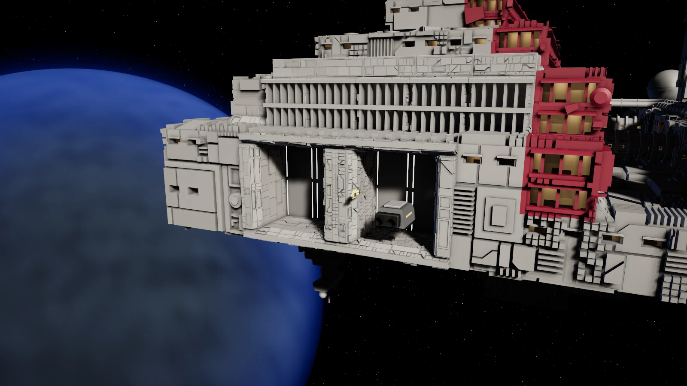
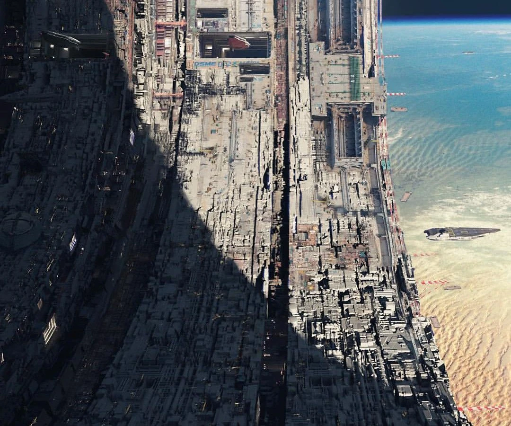

# Hull detail plan

Goal: the hull and interior walls hold up when a first-person player stands about 1 m away, and the station still reads as dense, crunchy detail out to orbit. The look is pixel art rendered smoothly in 3D, not photoreal.

## Distance bands

Each range uses the cheapest method that still looks right there, and each hands over smoothly to the next.

| Range | What draws the detail |
| --- | --- |
| 0 to about 20 m | Real geometry: tile meshes, carving and the small-object kit, plus procedural edges and fine detail in the shader. |
| About 20 to 200 m | The carving switches from mesh to a shader relief trace, which saves triangles and removes today's 110 m pop. Contact shadows keep its small shadows crisp. |
| Beyond about 200 m | Detail smaller than a pixel is folded into the material, then whole chunks are merged for the view from orbit. |

Contact shadows run at every distance, but up close the shadow map is already sharp, so they matter most in the middle band.

## Style target

- A warm highlight along edges that face the light; dark lines in seams and around parts.
- Clean graphic details: dot-grid grilles, rivets, cross marks, warning triangles, tiny indicator lights.
- Wear as flat chips along edges and a few big soft patches. No photographic scratches or rust.
- Chunky bevels and rounded corners relative to the size of each part.

## Close up: three layers

### 1. Metal base texture

- A small tiling set (albedo variation, roughness, a soft normal), painted and low in contrast so it supports the style instead of fighting it.
- Projected on the face plane in station space, like `TileSurface` does now: no UVs, seamless, and it works on all 24 tile orientations.
- Hashed tiling so the repeat doesn't show.

### 2. Procedural edges and fine detail (shader maths)

- Each vertex carries its position within its face rectangle and the rectangle's size in metres. The armour faces could reuse `uv1` and `uv2` (pane metres and pane size, used today only by window panes), or a new channel could be added.
- Each face edge is flagged convex, concave or tile seam. Seams get no bevel or wear, so the cube grid stays invisible.
- Convex edges: a rounded-bevel normal, a warm highlight, wear chips (stepped noise × the edge band) and glossy bare metal in the chips.
- Concave edges: dirt and darkening.
- Fine detail: screws at corners and along edges, micro-hole grids, carved lines shaded as grooves, small stencils.
- Everything is antialiased with `fwidth` and fades to its average tone and roughness by about 5–10 m, based on its size on screen.
- This layer is shading only. Anything deeper than about 2 cm stays geometry.

### 3. Small-object kit (instanced meshes)

- About 40 props: vents, hatches, junction boxes, pipe pieces, cable clips, lights, handles. Each has 2–3 LODs, chunky chamfers, and a curvature mask baked into vertex colour that drives the same wear as layer 2.
- Placed by the relief rules in slots on plates, deterministic in station space.
- Pipes and cables are spline meshes built with Burst.
- Only inside a ring around the player (about 10–20 m), grown in from flat at the ring's edge. Beyond the ring, their average darkening is folded into the material so the surface doesn't brighten when they leave.
- Drawn with GPU instancing (BatchRendererGroup or `RenderMeshIndirect`), one draw per prop type. The nearest ring gets simple box colliders.

## Middle range: relief trace and contact shadows

- The carving rules are ported to HLSL and evaluated from station-space position (kept in a spare UV channel, because the Foundry bends tiles onto the sphere grid).
- The pixel shader walks the view ray from piece edge to piece edge through the flat-topped pieces, traces once more toward the sun for hard self-shadows, and writes its own depth.
- Contact shadows: a 16–32 step march toward the sun through the depth buffer, 0.5–2 m long, multiplied into the main light's shadow in `StationLighting`.
- Carving pieces are lowered into their parents across a distance band instead of swapping per tile.

## Far range: folding and merged chunks

- When a level of detail drops out, its average effect goes into the parent's shading: sun visibility as a curve over sun height, cavity occlusion, the seams' share of albedo, and normal spread turned into roughness. The averages are measured once offline from the full detail.
- From orbit, each 8×8×8 chunk becomes one mesh of the massing, with the relief baked into a small normal and occlusion texture.

## Milestones

Each milestone ends with tile-lab snaps that compare before and after.

1. **Contact shadows.** Sun contact shadows in `StationLighting`. Check: lab snaps at 20, 60 and 150 m with and without them, under a low sun.
2. **Stylized surface.** `TileMesh` emits face-rectangle coordinates and edge flags; `TileSurface` gets the edge band, wear and specular behind a toggle. Lighting stays as it is. Check: snaps at 1, 5 and 20 m, plus the vertex and triangle budget.
3. **Fine detail and base texture.** Screws, hole grids, grooves and stencils in the shader; the painted metal set; fade-out by size on screen. Check: snaps at 1 and 5 m, and no shimmer when moving at 20 m.
4. **Kit near the player.** Ten props, placement rules, instancing, the ring with grow-in, and colliders in the nearest ring. Check: a walking camera path with no pops, and frame time.
5. **Pipes and cables.** Burst spline meshes routed between kit sockets. Check: the same walking path.
6. **Middle-range relief trace.** Carving rules in HLSL, the exact trace with self-shadows and depth write from about 20 m, lowering instead of the 110 m swap. Check: snaps from 20 to 250 m against the mesh carving, and the triangle saving.
7. **Far range.** Folded averages for each level as it drops out, then merged chunks for orbit. Check: snaps from 200 m to orbit against a supersampled reference.

## Open questions

- Do interiors use the same three layers?
- Which kit props block the player?
