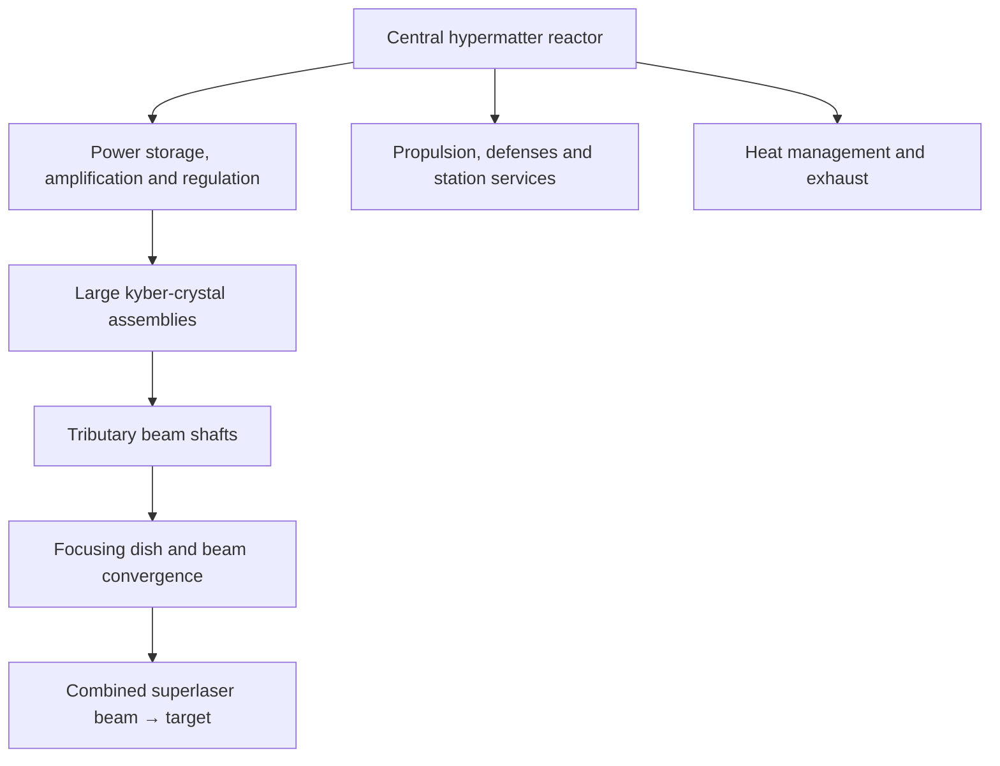

# Death Star: Operation, Components, Scale, and Technical Reference

Research compiled on 26 October 2026.

**The Death Star is a mobile military city built around an enormous power plant and a planet-destroying weapon.** Its superlaser is the central purpose; much of the station exists to power, aim, protect, maintain, and transport it.

There were two main stations. This document covers both, including information from *Rogue One* and *Andor*. **Current canon, older Legends material, and real-world calculations need to be kept separate:** published specifications sometimes contradict one another.

**The scale is extraordinary—even before considering the weapon.** The modern working dimensions are **160 km across for the first Death Star** and **200 km for the second**. Lucasfilm directly confirms the first figure; the revised 2017 *Return of the Jedi* junior novelization specifies the second. [Lucasfilm’s technical overview](https://www.starwars.com/news/star-wars-inside-intel-the-death-star), [2017 novelization passage reproduced in a source comparison](https://starwars.fandom.com/wiki/Talk%3ADS-2_Death_Star_II_Mobile_Battle_Station)

| Measurement | Death Star I | Death Star II |
|---|---:|---:|
| Diameter | 160 km / 99 miles | 200 km / 124 miles |
| Radius | 80 km | 100 km |
| Circumference, calculated | 503 km | 628 km |
| Exterior spherical area, calculated | 80,425 km² | 125,664 km² |
| Volume enclosed by the sphere, calculated | 2.14 million km³ | 4.19 million km³ |
| Condition during its decisive battle | Completed | Partially constructed; superlaser operational |
| Destruction | Battle of Yavin, *A New Hope* | Battle of Endor, *Return of the Jedi* |

Those volumes describe the station’s overall envelope, **not solid metal or usable floor space**. They include machinery, structural framing, chambers, shafts, hangars, and empty space.

Some useful ways to picture it:

- At **1:1,000 scale**, the first Death Star would still be **160 metres wide**. A 1.8-metre person would be 1.8 millimetres tall.
- Its vulnerable **two-metre exhaust port** would be just **two millimetres wide** on that model.
- Walking around its equator at 5 km/h would take **about 100 hours without stopping**.
- Increasing diameter from 160 to 200 km gives the second station **almost twice the enclosed volume**, despite being only 25% wider.
- Earth’s Moon is approximately **3,475 km across**, making it nearly 22 times wider than the first Death Star. “Moon-sized” means a *small* moon. [NASA’s Moon measurements](https://science.nasa.gov/moon/by-the-numbers/)

Older licensed material often uses **120 km and 160 km**, respectively. Even an EA *Battlefront II* article repeats that older scale. These are real publication inconsistencies, not different measurements of one agreed design. [EA’s station profile](https://www.ea.com/games/starwars/battlefront/news/tips-and-tricks-exploring-death-star-ii-in-battlefront-ii)

---

**The superlaser works through a chain of fictional energy-generation and focusing systems.** At a functional level:

This is a simplified systems diagram, not a literal piping plan.

The **hypermatter reactor** supplies the energy. Kyber assemblies focus and amplify it; the first station produces eight tributary beams that converge outside the dish into the main green beam. [Lucasfilm’s explanation](https://www.starwars.com/news/star-wars-inside-intel-the-death-star)

The crystals were a major scientific bottleneck. Galen Erso’s team worked on joining kyber fragments into larger structures and producing a stable, controllable beam. Thus, “eight giant crystals” does not necessarily mean eight enormous natural gemstones were simply excavated and installed intact. [Death Star scientists](https://www.starwars.com/databank/death-star-scientists)

The licensed diagrams name several intermediate components:

| Component | Role in the fictional system |
|---|---|
| Hypermatter reactor | Generates the station’s enormous energy supply |
| Primary power amplifier | Part of the energy-transfer system between reactor and weapon |
| Superlaser power cell | Stores energy for the weapon |
| Firing-field amplifier | Supports the weapon’s firing field |
| Induction hyperphase generators | Specialized components of the beam-generation system |
| Focusing coils and magnets | Control and concentrate the outgoing energy |
| Tributary beam shafts | Carry the separate beams toward the dish |
| Targeting-field generator | Part of the weapon’s targeting apparatus |

These names establish fictional components, but the books do **not** provide enough physical theory to turn them into functioning engineering designs. [*The Rebel Files*, reproduced technical pages 90–91](https://www.scribd.com/document/892150110/Star-Wars-The-Rebel-Files-Star-Wars-Books-Science-Daniel-Wallace-Adria-n-Rodriguez-Aaron-Riley-Chris-Star-Wars-Bellevue-WA-2018-978)

**A newer detail from *Andor* is that the reactor needs specialized mineral coatings.** The Empire wants Ghorman’s **deep-substrate foliated kalkite** to coat reactor lenses and stabilize energy output. Extracting it threatens the planet’s stability, which helps explain the Empire’s campaign against the Ghormans. Kalkite has a different role from kyber: it is associated with reactor-lens performance. [Krennic’s updated Databank entry](https://www.starwars.com/databank/director-orson-krennic)

**The weapon has adjustable output.** Its demonstrated uses include:

| Target | Result |
|---|---|
| Jedha’s Holy City | A reduced-output strike destroys the city and devastates the surrounding region |
| Scarif’s Imperial installation | Another reduced-output strike destroys the installation and surrounding area |
| Alderaan | A full planetary destruction |
| Rebel capital ships at Endor | Death Star II destroys individual warships |

The command “single reactor ignition” identifies a lower firing setting. It does not give us a reliable count of independent reactors or a complete explanation of how that setting is implemented. *Rogue One* demonstrates that destroying a location and destroying an entire world are different operating choices. [*Rogue One* dialogue and scene transcript](https://www.screenwritersnetwork.org/wp-content/uploads/2021/08/doc.pdf), [Death Star superlaser](https://www.starwars.com/databank/Death-Star-Superlaser)

---

**Inside the sphere is an industrial installation with inhabited districts.** The exterior’s tiny-looking details represent substantial buildings and machinery; inside are power networks, transport routes, operational areas, and living spaces.

The principal systems and spaces are:

| System or area | What it contains or does |
|---|---|
| **Armoured hull** | Quadanium-based exterior plating and structural framework |
| **Surface districts** | Buildings, equipment, weapons, access points, and service areas |
| **Equatorial trench** | Major docking arrangements and associated infrastructure |
| **Central reactor complex** | Main energy-generation machinery and its surrounding chamber |
| **Power-distribution network** | Central columns, converters, power cells, and processing equipment |
| **Superlaser installation** | Dish, beam shafts, focusing systems, and firing controls |
| **Computer network** | Central computing facilities and sector-level clusters |
| **Atmosphere systems** | Air processing and circulation |
| **Docking facilities** | Ship reception, hangars, control rooms, and handling facilities |
| **Internal transport** | Corridors, turbolifts, shafts, and connecting routes |
| **Security facilities** | Monitoring posts, detention areas, and interrogation facilities |
| **Crew facilities** | Quarters, recreation, medical care, and sanitation |
| **Maintenance areas** | Workshops and access to machinery |
| **Waste systems** | Collection, sorting, recycling, compaction, and disposal |
| **Command sector** | Operational control, conference rooms, and duty stations |

The *Rogue One* guide supplies the principal machinery labels; the Haynes manual expands the inhabited and service areas. [*Rogue One* technical diagrams](https://it.scribd.com/document/626895904/Star-Wars-Rogue-One-Ultimate-Visual-Guide), [Haynes publisher preview](https://au.haynes.com/products/imperial-death-star-manual)

Some surprisingly specific locations appear in the older manual: **Docking Bay 327, Detention Block AA-23, Maintenance Section 19-52, Medical Station 381-N3, and Hyperdrive Station A-226**. These are useful named examples, not a complete map of every compartment. [Manual contents preview](https://au.haynes.com/cdn/shop/files/Haynes-H5372-page-1.jpg?v=1724160380&width=1500)

The familiar films show only a tiny sampling: a hangar, control rooms, the conference chamber, detention corridors, a garbage compactor, maintenance shafts, and weapons-control spaces.

**There is ordinary daily life aboard it.** The Haynes author explains that offscreen facilities include medical wings and fitness centres. Its illustrated barracks use enclosed sleeping compartments inspired by clone-trooper accommodation. These details largely develop older roleplaying-game material, so they belong to the technical-reference tradition rather than being facts established on screen. [Interview with author Ryder Windham](https://clubjade.net/interview-ryder-windham-on-death-star-owners-technical-manual/)

Waste disposal is also more elaborate than one crushing room. The older manual describes sorting reusable material, recycling, multiple collection systems, and compactors. It even says the service sector breeds **dianogas** for use in compactors. Current screen canon firmly establishes a dianoga living in the compactor encountered by Luke, but that alone does not establish every detail of the older sanitation account. [Haynes waste-system preview](https://au.haynes.com/cdn/shop/files/Haynes-H5372-page-5.jpg?v=1724160380&width=1500), [Dianoga Databank](https://www.starwars.com/databank/dianoga)

**Gravity is artificially controlled.** A sphere does not automatically provide Earthlike gravity merely because it looks like a moon. Technical explanations describe different deck orientations in different regions—surface-adjacent areas and deeper internal sections need not share the same “down.” The franchise does not provide a complete, consistent gravity-field map for every compartment. [Discussion of Death Star deck orientation](https://www.sciencefocus.com/science/is-there-a-constant-up-on-all-the-death-stars-floors-or-is-the-core-always-down)

---

**Its conventional military systems are enormous in their own right.** Lucasfilm’s 2021 overview gives the first station approximately:

- **1.1–1.2 million Imperial personnel**, depending on mission.
- **7,000 TIE fighters**.
- **1,000 tractor beams**.
- **10,000 Super Blaster 920 laser cannons**.
- **50,000 heavy laser cannons**.
- **50,000 quad laser cannons**.
- A **Class 4 hyperdrive**.

Treat this as one published specification set; other reference books give different inventories. [Lucasfilm’s figures](https://www.starwars.com/news/star-wars-inside-intel-the-death-star)

The systems have distinct jobs:

- **Turbolasers and heavy batteries** attack larger spacecraft.
- **Lighter laser weapons** engage smaller targets.
- **Ion weapons** disable ship systems.
- **TIE fighters** intercept threats beyond the surface batteries’ effective coverage.
- **Tractor beams** seize or control spacecraft.
- **Shields and armour** protect the installation.

The first station’s defensive weakness was partly tactical: Rebel fighters could get through defenses intended to defeat a larger fleet assault. TIE fighters then had to engage them directly. [Official X-wing history](https://www.starwars.com/databank/x-wing-fighter-history-gallery)

The tractor beam that captures the *Millennium Falcon* is a separate system from the superlaser. Obi-Wan disables it so the ship can depart; the Empire subsequently follows the escapees using a planted tracking device. [*Millennium Falcon* history](https://www.starwars.com/databank/millennium-falcon)

The personnel figure also implies immense logistics. **As an illustrative calculation**, providing just one kilogram of food per person per day to 1.2 million people means **1,200 tonnes of food daily**, before packaging, water, spare parts, medical supplies, or fuel. Recycling and supply transport would be central operating concerns.

**The station can travel between star systems.** Its hyperdrive makes it a mobile threat; the first station’s pursuit to Yavin demonstrates that directly. Sublight propulsion handles local movement and orientation. A hyperdrive “class” is an in-universe rating, not a simple multiplier that can safely be converted into kilometres per second.

The major practical implication is that the Empire can bring the weapon to a target. It does not need a separate planet-killing installation in every system.

---

**Construction was a decades-long research and industrial programme.** It involved several different contributions:

| Contributor or location | Role |
|---|---|
| **Palpatine** | Political authority and strategic purpose |
| **Geonosians** | Early battle-station design and construction |
| **Tarkin** | Oversight, logistics, and eventual operational command |
| **Orson Krennic** | Advanced-weapons development and delivery of the project |
| **Galen Erso and fellow scientists** | Kyber research and a workable superlaser |
| **Geonosis** | Major early construction location |
| **Eadu** | Secret research laboratory |
| **Jedha** | Kyber extraction |
| **Ghorman** | Kalkite supply |
| **Narkina 5** | Prison labour producing components for the superlaser dish |
| **Scarif** | Imperial infrastructure and the engineering archive containing the plans |

The Geonosians had a station concept before they had solved the weapon’s practical operation. Galen’s contribution was therefore crucial, but he was not the sole architect of every corridor, engine, and defense system. [Lucasfilm on Geonosian design](https://www.starwars.com/news/much-to-learn-you-still-have-8-things-you-might-not-know-about-geonosians), [Eadu research facility](https://www.starwars.com/databank/eadu)

The plans are visible by *Attack of the Clones*, the station is under construction by the end of *Revenge of the Sith*, and the functioning weapon appears in *Rogue One* and *A New Hope*. The project spans roughly two decades, depending on where one starts counting design versus construction. The Empire also nearly exterminates the Geonosians to conceal its activities. [Geonosis history](https://www.starwars.com/databank/geonosis)

*Andor* makes the distributed manufacturing process especially clear: prisoners assemble components without knowing their ultimate purpose. The first-season finale’s post-credit scene shows those components being installed in the superlaser dish.

The stolen Scarif archive contains the station’s **design history**, including the introduced reactor flaw. It is engineering intelligence that lets the Rebels identify a feasible attack. [Death Star plans](https://www.starwars.com/databank/death-star-plans)

---

**The first Death Star’s destruction depends on sabotage, access, and a precise attack working together.**

1. **Galen introduces a catastrophic vulnerability into the reactor system.** His message describes an instability that an explosion can trigger.
2. **The Rebels obtain the engineering plans.** They need to discover how to reach that vulnerability.
3. **They identify a small thermal exhaust port**, approximately two metres wide, with a route into the reactor system.
4. **The target is ray-shielded**, so the attack uses proton torpedoes.
5. **Luke delivers the torpedoes through the port.**
6. **The reactor reaction destroys the station.**

The useful distinction is that **the exhaust route provides access; the reactor’s susceptibility makes the resulting failure catastrophic**. Reducing the explanation to “someone forgot to cover a hole” loses the central sabotage detail. [Galen’s explanation in *Rogue One*](https://www.screenwritersnetwork.org/wp-content/uploads/2021/08/doc.pdf), [official account of the torpedo attack](https://www.starwars.com/video/one-in-a-million-shot)

The small attack trench is also distinct from the enormous equatorial docking trench. Technical references identify the attack route as a **meridian trench**. [*The Rebel Files* technical account](https://www.scribd.com/document/892150110/Star-Wars-The-Rebel-Files-Star-Wars-Books-Science-Daniel-Wallace-Adria-n-Rodriguez-Aaron-Riley-Chris-Star-Wars-Bellevue-WA-2018-978)

It was still an extremely difficult attack: the port was tiny, the approach defended, and TIE fighters pursued the attackers. The films show failed attempts before Luke succeeds. [*A New Hope* story gallery](https://www.starwars.com/films/star-wars-episode-4-a-new-hope-story-gallery)

**Death Star II improves the weapon but is destroyed through a different route.** Its superlaser has better targeting sensors and power regulators, enabling the station to engage Rebel capital ships. Its operational weapon is concealed behind the appearance of an unfinished installation. [Superlaser Databank](https://www.starwars.com/databank/Death-Star-Superlaser)

Its decisive features are:

- **A larger overall structure.**
- **A functioning superlaser before the entire station is complete.**
- **Faster repeat firing**, described in the revised novelization as minutes rather than hours.
- **Protection from a shield projected from Endor’s forest moon.**
- **Open internal access through unfinished areas**, once that shield falls.

The Rebels therefore need two coordinated operations: the ground force destroys the shield generator, and the spacecraft enter the station to attack the reactor. Wedge attacks the reactor’s power regulator, while Lando’s *Falcon* strikes the reactor assembly. This is a direct internal attack, rather than another shot through the first station’s exhaust port. [Han’s ground operation](https://www.starwars.com/databank/han-solo), [*Falcon* reactor attack](https://www.starwars.com/databank/Millennium-Falcon)

Palpatine deliberately exposes the construction site as bait. The station is both a weapon and the centre of a trap for the Rebel fleet. [Death Star II Databank](https://www.starwars.com/databank/death-star-ii)

---

**Its strategic purpose is political terror.** Destroying Alderaan demonstrates that resistance can result in the loss of an entire world. The intended effect reaches far beyond the planet actually attacked: other governments are supposed to comply because the station might come to them.

That is why the Empire treats completion of the Death Star as a turning point in government. It can dissolve the Senate and rely more heavily on regional governors backed by overwhelming force. [Galactic Empire history](https://www.starwars.com/databank/organization/theempire/)

My interpretation is that its greatest strategic weakness is the concentration of resources and authority in a few enormous assets. Losing one station simultaneously means losing the weapon, its personnel, supporting infrastructure, senior commanders, and the credibility of its supposed invulnerability.

**Legends adds a different and much larger backstory.** Older material assigns substantial design responsibility to **Raith Sienar and Bevel Lemelisk**, includes a **prototype at the Maw Installation**, and describes construction over **Despayre**. These accounts should not be silently combined with Galen Erso’s current-canon story. The older *Complete Star Wars Encyclopedia* explicitly describes that prototype-and-Despayre history. [Older encyclopedia account](https://libertygalaxy.com/ebooks/starwars/The_Complete_Star_Wars_Encyclopedia_1.pdf)

Likewise, familiar figures such as a fixed **24-hour recharge**, precise deck totals, exact population counts, and detailed weapons inventories need an edition attached. They may be useful within one reference scheme without being universally consistent across the franchise.

---

**Real physics makes the energy supply and heat disposal much harder than building the sphere.** The following are calculations about an Earthlike target, not official Death Star specifications.

To disperse a planet so that gravity cannot simply pull it back together, the relevant starting point is its **gravitational binding energy**. For a simplified, uniform-density sphere:

\[
E \approx \frac{3GM^2}{5R}
\]

Using Earth’s mass and radius gives approximately:

\[
\boxed{E \approx 2.24\times10^{32}\ \text{joules}}
\]

That is an order-of-magnitude baseline. Real planetary structure, heating, inefficient energy transfer, and fast-moving debris alter the requirement. A University of Leicester student paper uses the same approach; its main calculation gives approximately \(2.25\times10^{32}\) J. [Original paper](https://journals.le.ac.uk/index.php/pst/article/download/1956/1858/2964), [NASA Earth data](https://nssdc.gsfc.nasa.gov/planetary/factsheet/earthfact.html)

For perspective, that energy corresponds to:

| Comparison | Calculated result |
|---|---:|
| Sun’s total output accumulated | About **6.8 days** |
| Average beam power if delivered over 10 seconds | **2.24 × 10³¹ watts** |
| Equivalent mass converted completely into energy | About **2.5 × 10¹⁵ kg** |
| Average charging power if accumulated in 24 hours | About **6.8 times the Sun’s luminosity** |

The 10-second shot and 24-hour charging period here are **illustrative assumptions**, not claims about a definitive firing specification. [NASA solar luminosity](https://nssdc.gsfc.nasa.gov/planetary/factsheet/sunfact.html?level=1)

Several problems remain even if the energy exists:

- **Heat rejection:** Space provides no surrounding air to carry heat away. A spacecraft ordinarily radiates heat or expels heated material. Merely installing a vent does not make astronomical quantities of heat disappear. [NASA thermal-control explanation](https://www.nasa.gov/smallsat-institute/sst-soa/thermal-control/)
- **Efficiency:** Even 1% waste from the illustrative shot would be roughly \(2.2\times10^{30}\) joules left to manage.
- **Beam combination:** Ordinary light beams cross; they do not naturally meet in empty space and turn into one new beam in another direction. The visible convergence requires fictional physics.
- **Energy storage and materials:** No demonstrated technology can store and route such energy through a station like this while preserving nearby machinery and people.
- **Recoil:** An ordinary electromagnetic beam carries momentum. A realistic analysis must account for the reaction on the weapon.
- **Artificial gravity and hyperspace:** Both require capabilities beyond demonstrated technology.

Destroying a planet’s civilization or rendering its surface uninhabitable would generally require much less energy than physically dispersing the whole planet. The Alderaan scene depicts the much more extreme outcome.

**Several specifications remain genuinely unresolved.** There is no consistently established engineering answer for the station’s total mass, bulk density, exact reactor output, complete fuel cycle, waste-heat budget, shielding efficiency, or detailed cost breakdown. Dollar-price estimates depend heavily on arbitrary assumptions about material, density, labour, and nonexistent technology.

Also, the Death Star does **not** use Starkiller Base’s star-draining mechanism. Starkiller is a different superweapon with a different fictional energy system. [Lucasfilm’s Starkiller explanation](https://www.starwars.com/news/star-wars-inside-intel-starkiller-base)

**For the deepest illustrated detail, these are the most useful references to continue with:**

- **[Death Star Owner’s Technical Manual](https://au.haynes.com/products/imperial-death-star-manual)** — the most directly focused technical tour: machinery, hangars, security, accommodation, maintenance, and the second station. Published before *Rogue One*, so its history includes Legends material.
- **[Rogue One: The Ultimate Visual Guide](https://dk.com/en-us/products/9781465452634-star-wars-rogue-one-the-ultimate-visual-guide)** — particularly useful for the current-canon project, personnel, materials, and engineering diagrams.
- **[Star Wars Complete Vehicles](https://dk.com/en-us/products/9780241504277-star-wars-complete-vehicles-new-edition)** — detailed cutaways and comparisons with other spacecraft.
- **[Lucasfilm’s Death Star overview](https://www.starwars.com/news/star-wars-inside-intel-the-death-star)** — a compact official account of the weapon, staffing, defenses, and mobility.
